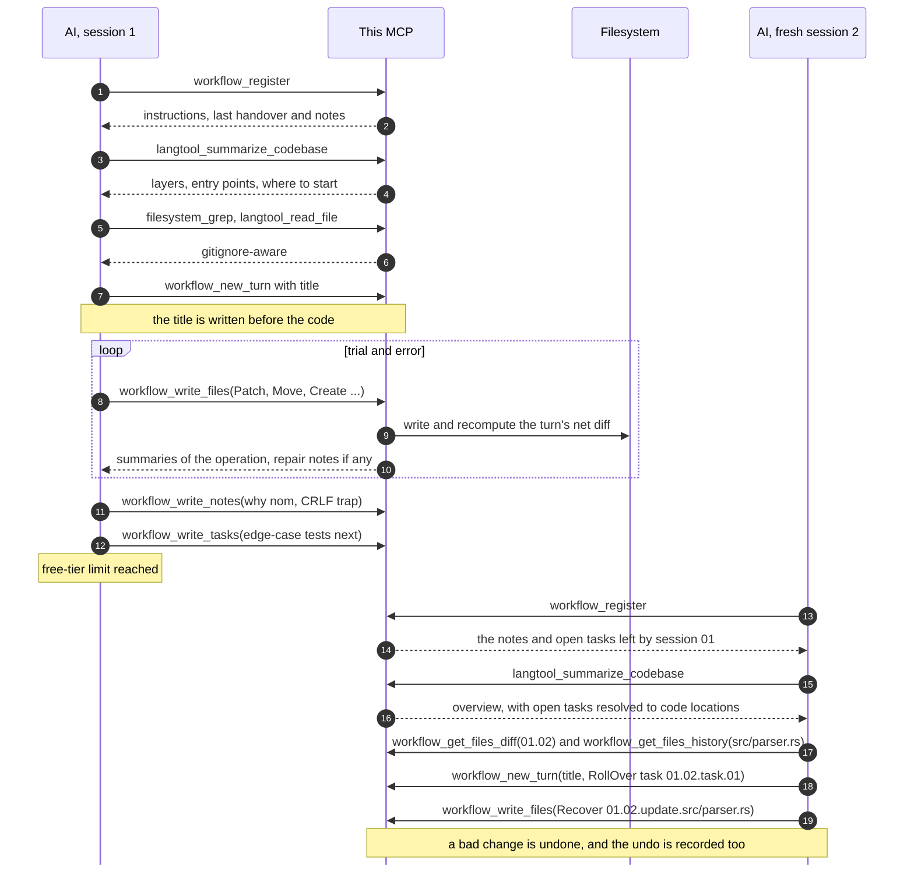
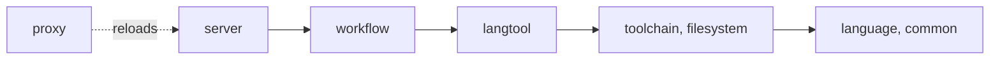

# Stateful Agent MCP

## What is this MCP?

This MCP server offers its own **code-intelligence tools** (currently only `rust` and `python` supported for advanced ones). It allows limited-token AI clients to work on our local codebase with minimal friction:

1. **Reason with code-intelligence tools**:

   This MCP server offers several tools that help the AI client inspect an unfamiliar codebase with a familiar reverse-engineering workflow and result formats, such as `find_symbols`, `find_references` and `view_callgraph`. \
   There are also heuristic tools like `summarize_workspace`, `summarize_symbol` and `summarize_feature` which use PageRank-like algorithms and were calibrated to reduce repeated warm-up patterns.

2. **Edit with various smart patch modes**:

   There are also high-level edit tools that work the way humans conveniently edit, such as `ReplaceSymbol`, `InsertBeforeSymbol`, `InsertAfterSymbol` and `RenameSymbol`.

3. **Get aligned by hints embedded in tool responses**:

   Inefficient tool call patterns are tracked to help AI clients learn gently and effectively during interaction time, instead of from long strict instructions at the beginning. \
   And similar to how humans interact with software, the MCP server can proactively offer choices for the AI client to pick to reduce redundant messages (like options of rebased states, location to insert when multiple ones found, etc.).

4. **Have high fault-tolerance**:

   There are smart resolvers underneath this MCP server that correct the most common mistakes, which saves tokens and time from wasteful retries. \
   When a patch can't be fixed safely, it announces an minimal report needed for the AI client's next try.

---

This MCP server also offers its own **git-like version management** which especially optimized for an effective workflow. It allows limited-token AI clients to work smoothly between small fresh sessions:

5. **Carry minimal cross-session context**:

   It supports the AI client to grab from relevant insight notes to the exact diff changes between any sessions, rather than being fed massive handoff documents.

6. **Work effectively as a relay race (1)**:

   This MCP server encourages the AI client to make dripping changes and proactively hand over the gaps that couldn't be filled right away from pre-existing context.

7. **Work effectively as a relay race (2)**:

   A fresh AI client can start working right away with contexted tasks from the prior AI client, rather than wasting time understanding the codebase or general plans from scratch.

8. **Have high conflict-resistance**:

   Concurrent edits made by us on disk are detected and automatically resolved or ignored when possible. \
   Otherwise, the AI client is notified of the critical changes and can resolve them with the minimal effort needed.

---

Besides the conveniences for AI clients, this MCP also aims for our convenience:

9. **Prioritize readability and reviewability**:

   The database of this MCP server is made of well-formatted `.md` files so that we can easily track the progress of incremental tasks, edit the insight notes, or review the file diffs, all within each turn.

10. **Prioritize automatic work loops**:

    Essential code actions like `lint`, `build` and `test` are available once we configure them, so that AI clients can verify the code by themselves without handing over such tasks back to us.

11. **No underlying language servers**:

    There are some well-known MCP servers that support code-intelligence tools, like [@oraios/serena](https://github.com/oraios/serena), yet they require heavy language servers that index the entire codebase on startup and fail to work with a wall of errors if there is any imperfect patch, which unlikely to ensure when writing code].

12. **Allow to code on itself without manual reload**:

    If there is any feature you want to improve or add, this repository also offers an alternative MCP server that can hot-reload the standard one. It allows the AI client to use the MCP server to code on itself, experiment with new changes immediately, and improve itself in a loop of self-evolution, without your intervention to restart the MCP server or the AI client.

## Why this MCP?

Many AI chat platforms nowadays (like Claude and ChatGPT) have limited free-tier usage and prohibit continuing a shared chat from another account (yes, they know there'll be ones like me).

If you can't afford Claude Code but have 10 Claude free-tier accounts, or have an ambitious project that comes with troubles when splitting long-running tasks into multiple sessions across multiple chat windows, then you might need an MCP server that not only lets AI work directly on your local codebase but also lets AI in different sessions understand each other's work and hand over tasks with minimal token usage.

## How it works?

### Workflow

A session is usually one chat window. When a project is opened, it sends the AI the project instructions, the MCP tools guide, a summary of the sessions and the last turn's information.

Here is a full round trip including the part where the chat runs out of tokens halfway:



### Layers

The code is split into crates, and each crate only depends on the ones below it.



### Storage layout

The state is plain files that you can review or edit by hand.

```text
.AGENTS/
├── INSTRUCTION.md                           your rules for this project (optional)
├── INSTRUCTION_FOR_CONTINUOUS_AGENTS.md     MCP workflow guide, auto-generated if empty
├── INSTRUCTION_FOR_SESSION_BASED_AGENTS.md  MCP workflow guide, auto-generated if empty
├── sessions/
│   ├── 01.md
│   └── 02.md
└── .deleted/
    └── 01.04/c.rs
```

`.AGENTS/sessions/01.md`:

````markdown
## TURN 01.01 — Add parser

### Notes

1. Switched to `nom` for parsing instead of regex for better performance.
2. [REF 01.01.note.01] The legacy config needs CRLF line endings, so the parser must not normalise them.

### Updates

<details>
<summary>Patch <code>src/parser.rs</code> (+4 -1)</summary>

```diff
@@ 12 @@
-fn parse(input: &str) -> Vec<Token> {
+pub fn parse(input: &str) -> Result<Vec<Token>> {
+    // Now handles empty inputs safely
+    if input.is_empty() { return Ok(vec![]); }
```

</details>

### Handover Tasks

1. [USER-EXPLICIT] Write tests for the edge cases in `src/parser.rs`.
2. [ROLLED-OVER 01.01.task.02] Hook up the parser to the CLI module.
````

> For further investigation, check out the real example applied directly to this codebase at [.AGENTS-example/sessions](.AGENTS-example/sessions).

The two usage guides are written once and then belong to your project, so edit them freely. `INSTRUCTION.md` holds the rules specific to your project; the server reads it but never creates it. This repository's `.gitignore` excludes session history and deleted-file copies. Whether to commit `.AGENTS/` in your own project depends on whether you want the history shared.

## Tools

<table>
  <thead>
    <tr>
      <th style="text-align:left;vertical-align:middle;">Scope</th>
      <th style="text-align:left;vertical-align:middle;">Permission</th>
      <th style="text-align:left;vertical-align:middle;">Name</th>
    </tr>
  </thead>
  <tbody>
    <tr>
      <td rowspan="11" style="text-align:left;vertical-align:middle;"><b>Workflow</b></td>
      <td rowspan="5" style="text-align:left;vertical-align:middle;">Write</td>
      <td style="text-align:left;vertical-align:middle;"><code>workflow_register</code></td>
    </tr>
    <tr>
      <td style="text-align:left;vertical-align:middle;"><code>workflow_new_turn</code></td>
    </tr>
    <tr>
      <td style="text-align:left;vertical-align:middle;"><code>workflow_write_files</code></td>
    </tr>
    <tr>
      <td style="text-align:left;vertical-align:middle;"><code>workflow_write_notes</code></td>
    </tr>
    <tr>
      <td style="text-align:left;vertical-align:middle;"><code>workflow_write_tasks</code></td>
    </tr>
    <tr>
      <td rowspan="6" style="text-align:left;vertical-align:middle;">Read-only</td>
      <td style="text-align:left;vertical-align:middle;"><code>workflow_get_notes</code></td>
    </tr>
    <tr>
      <td style="text-align:left;vertical-align:middle;"><code>workflow_get_tasks</code></td>
    </tr>
    <tr>
      <td style="text-align:left;vertical-align:middle;"><code>workflow_get_turns</code></td>
    </tr>
    <tr>
      <td style="text-align:left;vertical-align:middle;"><code>workflow_search</code></td>
    </tr>
    <tr>
      <td style="text-align:left;vertical-align:middle;"><code>workflow_get_files_diff</code></td>
    </tr>
    <tr>
      <td style="text-align:left;vertical-align:middle;"><code>workflow_get_files_history</code></td>
    </tr>
    <tr>
      <td rowspan="4" style="text-align:left;vertical-align:middle;"><b>Filesystem</b></td>
      <td rowspan="4" style="text-align:left;vertical-align:middle;">Read-only</td>
      <td style="text-align:left;vertical-align:middle;"><code>filesystem_ls</code></td>
    </tr>
    <tr>
      <td style="text-align:left;vertical-align:middle;"><code>filesystem_find</code></td>
    </tr>
    <tr>
      <td style="text-align:left;vertical-align:middle;"><code>filesystem_grep</code></td>
    </tr>
    <tr>
      <td style="text-align:left;vertical-align:middle;"><code>filesystem_file_metadata</code></td>
    </tr>
    <tr>
      <td rowspan="8" style="text-align:left;vertical-align:middle;"><b>Language-specific tools</b></td>
      <td rowspan="7" style="text-align:left;vertical-align:middle;">Read-only</td>
      <td style="text-align:left;vertical-align:middle;"><code>langtool_read_file</code></td>
    </tr>
    <tr>
      <td style="text-align:left;vertical-align:middle;"><code>langtool_find_symbols</code></td>
    </tr>
    <tr>
      <td style="text-align:left;vertical-align:middle;"><code>langtool_find_references</code></td>
    </tr>
    <tr>
      <td style="text-align:left;vertical-align:middle;"><code>langtool_view_callgraph</code></td>
    </tr>
    <tr>
      <td style="text-align:left;vertical-align:middle;"><code>langtool_summarize_codebase</code></td>
    </tr>
    <tr>
      <td style="text-align:left;vertical-align:middle;"><code>langtool_summarize_symbol</code></td>
    </tr>
    <tr>
      <td style="text-align:left;vertical-align:middle;"><code>langtool_summarize_feature</code></td>
    </tr>
    <tr>
      <td style="text-align:left;vertical-align:middle;">Write</td>
      <td style="text-align:left;vertical-align:middle;"><code>langtool_run_action</code></td>
    </tr>
  </tbody>
</table>

## Setup

Requires Rust 1.88 or newer.

```bash
git clone https://github.com/SnowyField1906/stateful-agent-mcp
cd stateful-agent-mcp
cargo test
cargo build --release
```

This is an example of how to configure tools for supported languages in `.AGENTS/config.toml`. If you want to disable a tool, just pass an empty string `""`. These settings are reloaded per session.

```toml
[rust]
format  = "rustfmt"
lint    = "cargo check {args}"
build   = "cargo build"
test    = "cargo test {args}"
install = "cargo add {args}"
remove  = "cargo remove {args}"

[python]
format  = "python -m black -q -"
lint    = "python -m black --check --quiet . {args}"
build   = "python -m compileall -q ."
test    = "python -m pytest {args}"
install = "python -m pip install {args}"
remove  = "python -m pip uninstall -y {args}"
```

The server speaks MCP over stdio and your client normally launches it. A typical entry:

```json
{
	"mcpServers": {
		"stateful-agent": {
			"command": "/path/to/stateful-agent-mcp/target/release/stateful-agent",
			"args": ["--mode", "session-based"]
		}
	}
}
```

The full usage:

```text
/path/to/stateful-agent-mcp/target/release/stateful-agent [OPTIONS] [PROJECT]

  [PROJECT]                         register this project at startup
  --mode <continuous|session-based> usage guide to serve (default: continuous)
  --max-output-bytes <BYTES>        cap for one tool result (default: 65536)
  --default-limit <COUNT>           default page size for listings (default: 200)
  --max-dir-depth <DEPTH>           maximum directory traversal depth (default: 24)
```

Then ask the AI to register your project by its absolute path.

The mode only changes the advice in the guide. `continuous` is for agents that run many tool calls in a row and move to a new turn after each settled step, like a commit. `session-based` is for chats that can be cut off at any time, so it keeps a handover ready all along. Logs go to stderr, and `STATEFUL_AGENT_MCP_LOG=debug` turns up the detail.

## Hot Reload Proxy

In case you want an AI client using `stateful-agent` to code on itself, experiment with new changes by itself, and then improve itself, all without our intervention. Then you can configure another MCP server `stateful-agent-proxy` which that can hot-reload the standard server and pass generic calls to the updated schema or new tools.

### Tools

<table>
  <thead>
    <tr>
      <th style="text-align:left;vertical-align:middle;">Scope</th>
      <th style="text-align:left;vertical-align:middle;">Permission</th>
      <th style="text-align:left;vertical-align:middle;">Name</th>
    </tr>
  </thead>
  <tbody>
    <tr>
      <td rowspan="3" style="text-align:left;vertical-align:middle;"><b>Proxy</b></td>
      <td rowspan="2" style="text-align:left;vertical-align:middle;">Write</td>
      <td style="text-align:left;vertical-align:middle;"><code>proxy_call_tool</code></td>
    </tr>
    <tr>
      <td style="text-align:left;vertical-align:middle;"><code>proxy_reload</code></td>
    </tr>
    <tr>
      <td style="text-align:left;vertical-align:middle;">Read-only</td>
      <td style="text-align:left;vertical-align:middle;"><code>proxy_list_tools</code></td>
    </tr>
  </tbody>
</table>

### Setup

```json
{
	"mcpServers": {
		"stateful-agent-proxy": {
			"command": "/path/to/stateful-agent-mcp/target/release/stateful-agent-proxy",
			"args": ["--mode", "session-based"]
		}
	}
}
```

It takes the same argument options as the standard one.

## Roadmap

- Support a `squash` tool that folds unnecessary past done sessions into fewer, compact, fresh ones.
- Support long-term `goals` to balance long-term instructions against short-term tasks.
- Support long-term `docs.{scope}` to balance long-term instructions against short-term notes.
- Encourage AI makes temporal tests for turn-specific changes with `scratch` instead of stuffing them into the main test files that procedures dead codes.

## License

Copyright (C) 2026 SnowyField

This project is licensed under the GNU Lesser General Public License, version 3 or (at your option) any later version (LGPL-3.0-or-later). The terms are in [COPYING.LESSER](COPYING.LESSER), which supplements the GNU General Public License version 3 in [COPYING](COPYING).
