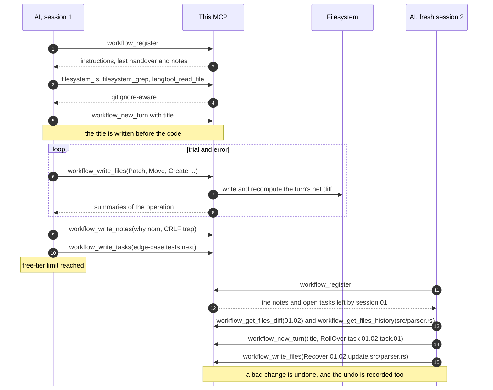

# Stateful Agent MCP

## What is this MCP?

This MCP server offers its **own git-like version management** and **code-intelligence tools** (only `rust` and `python` supported for now). It lets token-limited coding agents:

- Carry minimal cross-session context like insight notes, task handovers, or file diffs between versions.
- Have minimal token usage by reasoning over code-intelligence tools like read files with fold levels, find symbols, trace references or view call graph, etc.
- Patch directly to the registered local codebase with high fault-tolerance and human-review ability (with `.md` database files also served as logs).
- Execute essential code actions like `lint`, `build`, `test`, etc., while let the MCP server format files and squash changes in backstage.

Over the conveniences and token optimization, this MCP server is designed especially for my convention of "LLM-ergonomic" and "relay race" workflow.

## Why this MCP?

Many AI chat platforms nowadays (like Claude and ChatGPT) have limited free-tier usage and prohibit continuing a shared chat from another account (yes, they know there'll be ones like me).

If you can't afford Claude Code but have 10 Claude free-tier accounts, or have ambitious projects that come with troubles when splitting long-running tasks into multiple sessions across multiple chat windows, then you might need an MCP server that lets AI of different sessions understand each other's work and handover tasks with minimal token usage.

_Nowadays it's filled with_:

1. **Generous token usage yet stupid AIs**: Gemini is really cheap, yet I have many problems with its habit of exaggeration and ostentation.
2. **Smart yet stingy token usage AIs**: I extremely love Claude, yet I suffer a lot when carefully considering tokens to give tasks, instructions, and the codebase to it.
3. **Cheap yet limited-capacity conversational AIs**: AI agents are powerful yet only offered at expensive prices, whereas conversational platforms (like AI Studio, Gemini, etc.) are very limited in understanding tasks and code on your computer properly.

...and this MCP just _enables the fourth option_.

## On the "LLM-ergonomic workflow" philosophy

Humans and LLMs work in very different ways, and we unintentionally design it following our heuristics. This MCP is built around bending a few human habits into something an LLM can actually survive.

### ~~Brutely align with instructions~~ → Gently align AI with hints embedded in tool call responses

Massive instructions consume token unnecessarily before ever starting anything. And strict instructions makes AI act in extreme manner due to pink-elephant phenomenon _(if you're told to not imagine a pink elephant, you can't help but imagine it or get distracted)_.

Most systems on this world follows by attractor dynamics _(i.e. systems doesn't need to know or compute where is the ground state among the landscapes, but only react to the local rules/forces/feedbacks at the current until reaching balance point)_, because only that process can make complex things possible.

Being inspired by it, I discovered that instead of trying to align the AI in the beginning, gently hinting what to do next within tool call responses will consume much less tokens and work much more effectively. The MCP also keeps track of AI habits in the session so that it can proactively embed recommendations when needed without brute interruptions.

By this, the AI will be gently and naturally aligned with the workflow orbit just by repeated interactions with tool calls, without wasting token unnecessarily or making it behave extremely.

### ~~Brutely ask do to defined goal or plans~~ → Let AI proactively handing over necessary updates next

Giving one big task is obviously a bad idea because it has to guess its own location in every fresh session. Yet dividing it into several small tasks is not better either because not only it will be get lost but also coding tasks are interdependent in nature.

But when AI has worked on a task and handover the gaps it couldn't fill right away, it's more effective and easy to track the progress than sending same task or plan table over and again. And the context only ever holds the next step.

All handover tasks are automatically treated as done within turn unless explicitly passed to next turn with `RollOver`, which I expect to reinforce its awareness of the work.

### ~~Feed previous turns' responses for context~~ → Provide cleaner context from code diffs and side notes within

Presenting updates of work in natural language encourages worthless exaggeration and dangerous deception, also the last-session AI is likely not able to generate work summaries since it often runs out of token halfway.

So instead of letting next-session AI reading conversation or summary of works, reading file diffs is much more effective and token-efficient regarding understanding past context and previous attempts along with the insights and tasks at that point.

Notes keep critical insights or what a later turn could not guess.
By letting current turn settle grounding points with insight notes and explicit direction with practical small tasks. It becomes easier to follow up unfinished work and track the progress.

Allowing extracting insight notes and incremental short-term tasks across between checkpoints is incredibly powerful regarding to study tasks.

### ~~Send the entire codebase~~ → Let AI reason with code-intelligence tools

Pareto rule says that only 20% actors takes responsibility for 80% consequences. Regardless of the codebase size, you can still deliver the major of important information in just 20% tokens.

With such code intelligence tools like `langtool_find_symbols`, `langtool_find_references`, or `langtool_view_callgraph` enabled, AI doesn't need to trace file by file over codebase but can analyze it systematically and effectively. Which empowers it further more than just understanding session context by file diffs.

### ~~Demand perfect responses~~ → Tolerate dripping changes

Like how most coding agents nowadays work, instead of letting it attempt to get most things right at once. It's more flexible and recoverable to patch multiple times like soft checkpoints, and the MCP just automatically squashes them into net diffs in backstage.

Also, when AI creates a turn, it means the AI has understood most of the context and ready to make first changes. So it's better to let AI decides right away what to do as a ground point instead of having an unclear plan and chasing the unfinished tasks indefinitely.

## On other design choices

### Prioritize recoverability and human reviewability

The database of this MCP server is intentionally `.md` files in `.AGENTS/sessions/`, which are well-formatted and clean information that you can read exactly what the AI does in each turn. It prioritizes reporting insights and tasks directly in those files rather than wasting tokens by presenting them again in the chat.

Also all trial-and-error updates in a single turn are automatically squashed by the MCP so that the changes are minimal for our readable ability and AI's optimal token usage in future review.

If you're'm non-tech or too lazy to review such logs, then that's okay, you can let another AI review everything since the MCP server itself is stateful. It can recover things if you want. And it can recover recovered things if you trust it again.

### Prioritize automatic work loops

You might have suffered the experience where it generates a bad code snippet, you scold it, and then it gives you a _better code snippet_ instead of a _better code snippet that also recovers the previous bad code snippet_.

Not only do you have to copy, find the place, select the code, and paste it, but you also can't follow its changes and you end up with a lot of dead code. And once it runs out of tokens, you have to present everything all over again in another fresh and token-limited chat window.

And you will have to repeatedly reports failed tests and build errors when it demands. AI should do repeated things, yet you're the only one who ends up doing so.

With `test` or `build` tools enabled, it can keep follow up previous work and make new tasks indefinitely without having workflow messed up by your interruptions or handing over test/build tasks back to you.

## How it works?

A **session** is one run, usually one chat window. When a project is opened, it sends the AI set of project instruction, MCP tools guide, summary of sessions and last turn's information.

Here is a full round trip, including the part where the chat runs out of tokens halfway:



## Storage layout

The state is plain files that you can read on GitHub, review, and edit by hand.

```text
.AGENTS/
├── INSTRUCTION.md                           your rules for this project (optional)
├── INSTRUCTION_FOR_CONTINUOUS_AGENTS.md     MCP workflow guide, auto-generated if empty
├── INSTRUCTION_FOR_SESSION_BASED_AGENTS.md  MCP workflow guide, auto-generated if empty
├── sessions/
│   ├── 01.md
│   └── 02.md
└── .deleted/
    └── 01.04/c.rs
```

`.AGENTS/sessions/01.md`:

````markdown
## TURN 01.01 — Add parser

### Notes

1. Switched to `nom` for parsing instead of regex for better performance.
2. [REF 01.01.note.01] The legacy config needs CRLF line endings, so the parser must not normalise them.

### Updates

<details>
<summary>Patch <code>src/parser.rs</code> (+4 -1)</summary>

```diff
@@ 12 @@
-fn parse(input: &str) -> Vec<Token> {
+pub fn parse(input: &str) -> Result<Vec<Token>> {
+    // Now handles empty inputs safely
+    if input.is_empty() { return Ok(vec![]); }
```

</details>

### Handover Tasks

1. [USER-EXPLICIT] Write tests for the edge cases in `src/parser.rs`.
2. [ROLLED-OVER 01.01.task.02] Hook up the parser to the CLI module.
````

> For further investigation, check out the real example applied directly to this codebase at [.AGENTS-example/sessions](.AGENTS-example/sessions).

The two usage guides are written once and then belong to your project, so edit them freely. `INSTRUCTION.md` holds the rules specific to your project; the server reads it but never creates it. This repository's `.gitignore` excludes session history and deleted-file copies. Whether to commit `.AGENTS/` in your own project depends on whether you want the history shared.

## Tools

<table>
  <thead>
    <tr>
      <th style="text-align:left;vertical-align:middle;">Scope</th>
      <th style="text-align:left;vertical-align:middle;">Permission</th>
      <th style="text-align:left;vertical-align:middle;">Name</th>
    </tr>
  </thead>
  <tbody>
    <tr>
      <td rowspan="11" style="text-align:left;vertical-align:middle;"><b>Workflow</b></td>
      <td rowspan="5" style="text-align:left;vertical-align:middle;">Write</td>
      <td style="text-align:left;vertical-align:middle;"><code>workflow_register</code></td>
    </tr>
    <tr>
      <td style="text-align:left;vertical-align:middle;"><code>workflow_new_turn</code></td>
    </tr>
    <tr>
      <td style="text-align:left;vertical-align:middle;"><code>workflow_write_files</code></td>
    </tr>
    <tr>
      <td style="text-align:left;vertical-align:middle;"><code>workflow_write_notes</code></td>
    </tr>
    <tr>
      <td style="text-align:left;vertical-align:middle;"><code>workflow_write_tasks</code></td>
    </tr>
    <tr>
      <td rowspan="6" style="text-align:left;vertical-align:middle;">Read-only</td>
      <td style="text-align:left;vertical-align:middle;"><code>workflow_get_notes</code></td>
    </tr>
    <tr>
      <td style="text-align:left;vertical-align:middle;"><code>workflow_get_tasks</code></td>
    </tr>
    <tr>
      <td style="text-align:left;vertical-align:middle;"><code>workflow_get_turns</code></td>
    </tr>
    <tr>
      <td style="text-align:left;vertical-align:middle;"><code>workflow_search</code></td>
    </tr>
    <tr>
      <td style="text-align:left;vertical-align:middle;"><code>workflow_get_files_diff</code></td>
    </tr>
    <tr>
      <td style="text-align:left;vertical-align:middle;"><code>workflow_get_files_history</code></td>
    </tr>
    <tr>
      <td rowspan="4" style="text-align:left;vertical-align:middle;"><b>Filesystem</b></td>
      <td rowspan="4" style="text-align:left;vertical-align:middle;">Read-only</td>
      <td style="text-align:left;vertical-align:middle;"><code>filesystem_ls</code></td>
    </tr>
    <tr>
      <td style="text-align:left;vertical-align:middle;"><code>filesystem_find</code></td>
    </tr>
    <tr>
      <td style="text-align:left;vertical-align:middle;"><code>filesystem_grep</code></td>
    </tr>
    <tr>
      <td style="text-align:left;vertical-align:middle;"><code>filesystem_file_metadata</code></td>
    </tr>
    <tr>
      <td rowspan="5" style="text-align:left;vertical-align:middle;"><b>Language-specific tools</b></td>
      <td rowspan="4" style="text-align:left;vertical-align:middle;">Read-only</td>
      <td style="text-align:left;vertical-align:middle;"><code>langtool_read_file</code></td>
    </tr>
    <tr>
      <td style="text-align:left;vertical-align:middle;"><code>langtool_find_symbols</code></td>
    </tr>
    <tr>
      <td style="text-align:left;vertical-align:middle;"><code>langtool_find_references</code></td>
    </tr>
    <tr>
      <td style="text-align:left;vertical-align:middle;"><code>langtool_view_callgraph</code></td>
    </tr>
    <tr>
      <td style="text-align:left;vertical-align:middle;">Write</td>
      <td style="text-align:left;vertical-align:middle;"><code>langtool_run_action</code></td>
    </tr>
  </tbody>
</table>

## Setup

Requires Rust 1.88 or newer.

```bash
git clone https://github.com/SnowyField1906/stateful-agent-mcp
cd stateful-agent-mcp
cargo test
cargo build --release
```

This is an example of how to configure tools for supported languages in `.AGENTS/config.toml`, if you want to disable a tool, just pass an empty string `""`. These settings are re-loaded per session.

```toml
[rust]
format  = "rustfmt"
lint    = "cargo check {args}"
build   = "cargo build"
test    = "cargo test {args}"
install = "cargo add {args}"
remove  = "cargo remove {args}"

[python]
format  = "python -m black -q -"
lint    = "python -m black --check --quiet . {args}"
build   = "python -m compileall -q ."
test    = "cargo test {args}"
install = "python -m pip install {args}"
remove  = "python -m pip uninstall -y {args}"
```

The server speaks MCP over stdio and your client normally launches it. A typical entry:

```json
{
	"mcpServers": {
		"agent-mcp": {
			"command": "/path/to/stateful-agent-mcp/target/release/agent-mcp",
			"args": ["--mode", "session-based"]
		}
	}
}
```

More specific schema:

```text
/path/to/stateful-agent-mcp/target/release/agent-mcp [OPTIONS] [PROJECT]

  [PROJECT]                         register this project at startup
  --mode <continuous|session-based> usage guide to serve (default: continuous)
  --max-output-bytes <BYTES>        cap for one tool result (default: 65536)
  --default-limit <COUNT>           default page size for listings (default: 200)
  --max-dir-depth <DEPTH>           maximum directory traversal depth (default: 24)
```

Then ask the AI to register your project by its absolute path.

The mode only changes the advice in the guide. `continuous` is for agents that run many tool calls in a row and moves to a new turn after each settled step, like a commit. `session-based` is for chats that can be cut off at any time, so it keeps a handover ready all along. Logs go to stderr, and `STATEFUL_AGENT_MCP_LOG=debug` turns up the detail.

## Roadmap

- Handle concurrent mid-turn edits made directly by the user on disk.
- Support configuring external code formatters and linters on the server.
- Support a "squash" tool that folds unnecessary past done sessions into fewer, compact, fresh ones.
- Support long-term "goals" to balance long-term instructions against short-term tasks.
- Support long-term "docs.{scope}" to balance long-term instructions against short-term notes.
- Encourage AI makes temporal tests for turn-specific changes with `scratch-test` instead of stuffing them into the main test files that procedures dead codes.

## License

Copyright (C) 2026 SnowyField

This project is licensed under the GNU Lesser General Public License, version 3 or (at your option) any later version (LGPL-3.0-or-later). The terms are in [COPYING.LESSER](COPYING.LESSER), which supplements the GNU General Public License version 3 in [COPYING](COPYING).
