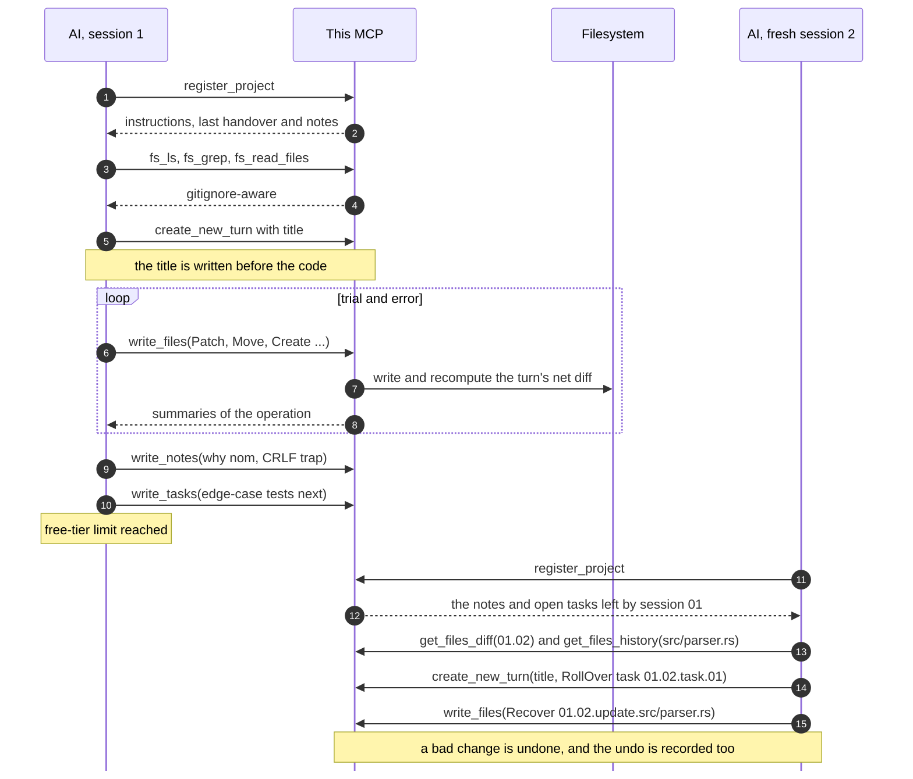

# Stateful Agent MCP

## What is this MCP?

This MCP server offers its **own git-like version management** and **code intelligence tools** (only `rust` and `python` supported for now). It lets token-limited coding agents:

- Carry minimal cross-session context like insight notes, task handovers, or file diffs between versions.
- Have minimal token usage with code intelligence tools like `read_file` with fold depths, `find_symbols`, `find_references`, or `view_callgraph`.
- Patch directly to the registered local codebase with high fault-tolerance and human-review ability (with `.md` database files also served as logs).
- Execute essential code actions like `lint`, `build`, `test`, etc., while let the MCP server format files and squash changes in backstage.

## Why this MCP?

Many AI chat platforms nowadays (like Claude and ChatGPT) have limited free-tier usage and prohibit continuing a shared chat from another account (yes, they know there'll be ones like me).

If you can't afford Claude Code but have 10 Claude free-tier accounts, or have ambitious projects that come with troubles when splitting long-running tasks into multiple sessions across multiple chat windows, then you might need an MCP server that lets AI of different sessions understand each other's work and handover tasks with minimal token usage.

_Nowadays it's filled with_:

1. **Generous token usage yet stupid AIs**: Gemini is really cheap, yet I have many problems with its habit of exaggeration and ostentation.
2. **Smart yet stingy token usage AIs**: I extremely love Claude, yet I suffer a lot when carefully considering tokens to give tasks, instructions, and the codebase to it.
3. **Cheap yet limited-capacity conversational AIs**: AI agents are powerful yet only offered at expensive prices, whereas conversational platforms (like AI Studio, Gemini, etc.) are very limited in understanding tasks and code on your computer properly.

...and this MCP just _enables the fourth option_.

## How optimized it is?

### Strategy 1: Prioritize quick insights and short-term handover tasks over long instructions

Not only massive instructions take away a large amount of tokens without ever starting anything, ambitious long tasks also make AI distracted, dilute information, and encourage hallucination.

By let current turn settle grounding points with insight notes and explicit direction with practical small tasks. The progress becomes easier to follow up unfinished work and track the progress.

Allowing reading insight notes with incremental short-term tasks across any range of sessions is incredibly powerful regarding to study tasks.

### Strategy 2: Prioritize reviewing file diffs between versions over reading entire codebase

If you have a long-running task, this MCP server splits it into smaller practical ones by its own decision, which can be handed over and tracked easily. So it should also be able to split the codebase by letting the AI pick what it wants to read.

Presenting updates of work in natural language encourages worthless exaggeration and dangerous deception, also the last-session AI is likely not able to generate work summaries since it often runs out of token halfway.

So instead of letting next-session AI reading conversation or summary of works, reading file diffs is much more effective and token-efficient regarding understanding past context and previous attempts along with the insights and tasks at that point.

### Strategy 3: Prioritize code intelligence tools over manual traces

Pareto rule says that only 20% actors takes responsibility for 80% consequences. Regardless of the codebase size, you can still deliver the major of important information in just 20% tokens.

With such code intelligence tools like `find_symbols`, `find_references`, or `view_callgraph` enabled, AI doesn't need to trace file by file over codebase but can analyze it systematically and effectively. Which empowers it further more than just understanding session context by file diffs.

### Philosophy 1: Prioritize LLM-ergonomic workflow

Humans and LLMs work in very different ways, and we unintentionally design it following our heuristics. This MCP is built around bending a few human habits into something an LLM can actually survive.

| What a human does                                                                               | Why it hurts an LLM                                                                           | What this MCP does                                                                                                                                                                   |
| :---------------------------------------------------------------------------------------------- | :-------------------------------------------------------------------------------------------- | :----------------------------------------------------------------------------------------------------------------------------------------------------------------------------------- |
| Plans a big feature in their head, then codes for five hours and ticks the task off at the end. | Working memory over a long task is terrible. The plan drifts and the hallucinations creep in. | Write valuable insights as ground points, then update files and describe (or rollover) tasks for the gaps it couldn't fill right away. So the context only ever holds the next step. |
| Writes the commit message last.                                                                 | The model starts typing code before it has decided what it is doing.                          | "Commit message" is required at the moment the turn opens together with some first changes. This acts as a forced chain of thought and makes it practical.                           |
| Gets it mostly right locally then commits.                                                      | The patches are rarely right on the first try, and every retry bloats the history.            | Call `write_files` as many times as they like. Each call is a soft checkpoint, and the MCP server automatically squashes them into net diffs.                                        |
| Opens files until the codebase makes sense.                                                     | Can't afford to read everything and shouldn't have to.                                        | Looks through lenses of growing detail: session summary, then notes and tasks, then one file's history, then a single turn's diff, then the file itself at that moment.              |
| Digs through chat logs or JSON dumps to see what happened.                                      | Neither the human nor the next AI wants to.                                                   | State is plain Markdown with exact diffs and the insights that matter, readable on GitHub like a changelog somebody actually cared about.                                            |

### Philosophy 2: Prioritize recoverability and human reviewability

The database of this MCP server is intentionally `.md` files in `.AGENTS/sessions/`, which are well-formatted and clean information that you can read exactly what the AI does in each turn. It prioritizes reporting insights and tasks directly in those files rather than wasting tokens by presenting them again in the chat.

Also all trial-and-error updates in a single turn are automatically squashed by the MCP so that the changes are minimal for our readable ability and AI's optimal token usage in future review.

If you're'm non-tech or too lazy to review such logs, then that's okay, you can let another AI review everything since the MCP server itself is stateful. It can recover things if you want. And it can recover recovered things if you trust it again.

### Philosophy 3: Prioritize automatic work loops

You might have suffered the experience where it generates a bad code snippet, you scold it, and then it gives you a _better code snippet_ instead of a _better code snippet that also recovers the previous bad code snippet_.

Not only do you have to copy, find the place, select the code, and paste it, but you also can't follow its changes and you end up with a lot of dead code. And once it runs out of tokens, you have to present everything all over again in another fresh and token-limited chat window.

And you will have to repeatedly reports failed tests and build errors when it demands. AI should do repeated things, yet you're the only one who ends up doing so.

With `test` or `build` tools enabled, it can keep follow up previous work and make new tasks indefinitely without having workflow messed up by your interruptions or handing over test/build tasks back to you.

## How it works?

### Session lifecycle

A **session** is one run, usually one chat window. When a project is opened, it sends the AI set of project instruction, MCP tools guide, summary of sessions and last turn's information.

Here is a full round trip, including the part where the chat runs out of tokens halfway:



### Notes and handover tasks

They look similar but do different jobs. Notes keep critical insights or what a later turn could not guess. A note can point at earlier ones with `ref_notes` so nothing gets repeated. Handover tasks are short-term work for the next turn or session, not a backlog. Tasks that come straight from you are flagged `user_explicit`, so a later session knows they outrank the agent's own ideas.

If the AI starts new turn without rolling over tasks, they are implicitly set as finished. So explicit do `RollOver` unfinished tasks after each turn is my intentional design that expects AI to be awarded of tasks and reinforces its memory.

### Messy in, clean out

I let the AI be messy on purpose. A turn can take as many `write_files` calls as it wants, and the MCP keeps only the end result. Say an agent is asked to move `src/auth.rs` into a module folder and raise a timeout:

```text
write_files  Patch src/auth.rs          timeout 5 -> 30
             → Patch src/auth.rs +1 -1 at 12
write_files  Create scratch.txt         (testing an idea)
             → Create scratch.txt (4 lines)
write_files  Delete scratch.txt
             Move src/auth.rs -> src/auth/mod.rs
             Patch src/auth/mod.rs      timeout 30 -> 10
```

Three calls and five operations later, this is everything the turn records:

```text
Move src/auth.rs → src/auth/mod.rs
Patch src/auth/mod.rs +1 -1
@@ -12,1 +12,1 @@
-    let timeout = 5;
+    let timeout = 10;
```

| During the turn                                             | The turn records                                                     |
| :---------------------------------------------------------- | :------------------------------------------------------------------- |
| The same line is patched three times                        | One hunk, from the first version to the last                         |
| A file is edited, then edited back                          | Nothing                                                              |
| A file is created, then deleted                             | Nothing                                                              |
| A file is moved, then edited                                | `Move`, then a `Patch` at the new path                               |
| `a.rs` is deleted and `b.rs` appears with identical content | `Move a.rs → b.rs`, preferring a candidate with the same file name   |
| A folder is moved                                           | One `Move` per file                                                  |
| A folder is deleted                                         | One `Delete` per file, with the contents kept in `.AGENTS/.deleted/` |

Everything recorded uses the same operations `write_files` accepts, so a diff the server shows you can be fed straight back to it. Read a range backwards (`01.05..01.02`) and you get the operations that undo it.

### The past, without snapshots

No copy of the project is ever stored. The MCP keeps the diffs and the content of deleted files, and rebuilds an old state by running the diffs backwards from your files as they are today. Here is `src/a.rs` as of turn `01.01`, after it was renamed and patched:

```text
read a.rs as of 01.01
  01.02  Move a.rs → b.rs       follow the name forward
  01.03  Patch b.rs +3 -1       remember the hunks
  now    b.rs on disk           start here, undo the hunks, done
```

If the file was deleted later on, the walk starts from its copy in `.AGENTS/.deleted/` instead of from the disk. The same mechanism gives you `at_implicit_id` on `fs_read_files` (any file as it stood at the end of a turn), inverse diffs, and `Recover`, which restores a file, a folder, or everything a range of turns touched. A recovery is recorded like any other change, so it can be recovered too.

Every history tool takes the same selectors: `01` a session, `01.02` a turn, `01.01..01.03` a range, `HEAD~2` two turns before the open one, `01.02.note.01` one note, `01.02.update.src/a.rs` one file's change in one turn.

## Storage layout

The state is plain files that you can read on GitHub, review, and edit by hand.

```text
.AGENTS/
├── INSTRUCTION.md                           your rules for this project (optional)
├── INSTRUCTION_FOR_CONTINUOUS_AGENTS.md     MCP workflow guide, auto-generated if empty
├── INSTRUCTION_FOR_SESSION_BASED_AGENTS.md  MCP workflow guide, auto-generated if empty
├── sessions/
│   ├── 01.md
│   └── 02.md
└── .deleted/
    └── 01.04/c.rs
```

`.AGENTS/sessions/01.md`:

````markdown
## TURN 01.01 — Add parser

### Notes

1. Switched to `nom` for parsing instead of regex for better performance.
2. [REF 01.01.note.01] The legacy config needs CRLF line endings, so the parser must not normalise them.

### Updates

<details>
<summary>Patch <code>src/parser.rs</code> (+4 -1)</summary>

```diff
@@ 12 @@
-fn parse(input: &str) -> Vec<Token> {
+pub fn parse(input: &str) -> Result<Vec<Token>> {
+    // Now handles empty inputs safely
+    if input.is_empty() { return Ok(vec![]); }
```

</details>

### Handover Tasks

1. [USER-EXPLICIT] Write tests for the edge cases in `src/parser.rs`.
2. [ROLLED-OVER 01.01.task.02] Hook up the parser to the CLI module.
````

> For further investigation, check out the real example applied directly to this codebase at [.AGENTS-example/sessions](.AGENTS-example/sessions).

The two usage guides are written once and then belong to your project, so edit them freely. `INSTRUCTION.md` holds the rules specific to your project; the server reads it but never creates it. This repository's `.gitignore` excludes session history and deleted-file copies. Whether to commit `.AGENTS/` in your own project depends on whether you want the history shared.

## Tools

<table>
  <thead>
    <tr>
      <th style="text-align:left;vertical-align:middle;">Scope</th>
      <th style="text-align:left;vertical-align:middle;">Tool</th>
      <th style="text-align:left;vertical-align:middle;">Request / Response</th>
    </tr>
  </thead>
  <tbody>
    <tr>
      <td rowspan="18" style="text-align:left;vertical-align:middle;"><b>Workflow</b></td>
      <td rowspan="2" style="text-align:left;vertical-align:middle;"><code>workflow_register</code><br>(Write)</td>
      <td style="text-align:left;vertical-align:middle;"><code>{ folder_path, show_instructions?, show_last_turn_info? }</code></td>
    </tr>
    <tr>
      <td style="text-align:left;vertical-align:middle;"><code>{ project_root, active_turn_id, language_capabilities?, language_config_error?, instructions?: { guide, project? }, last_turn?: { turn_id, title?, notes?, updates?, handover_tasks?, handover_tasks_from_turn? }, sessions, sessions_total? }</code></td>
    </tr>
    <tr>
      <td rowspan="2" style="text-align:left;vertical-align:middle;"><code>workflow_new_turn</code><br>(Write)</td>
      <td style="text-align:left;vertical-align:middle;"><code>{ title?, write_notes?, write_tasks?, write_files? }</code></td>
    </tr>
    <tr>
      <td style="text-align:left;vertical-align:middle;"><code>{ turn_id, closed? | note?, note_ids?, task_ids?, updates?, format_warnings? }</code></td>
    </tr>
    <tr>
      <td rowspan="2" style="text-align:left;vertical-align:middle;"><code>workflow_write_files</code><br>(Write)</td>
      <td style="text-align:left;vertical-align:middle;"><code>{ ops: [Create | Move | Patch | Delete | Recover] }</code></td>
    </tr>
    <tr>
      <td style="text-align:left;vertical-align:middle;"><code>{ turn_id, updates, changed?, format_warnings? }</code></td>
    </tr>
    <tr>
      <td rowspan="2" style="text-align:left;vertical-align:middle;"><code>workflow_write_notes</code><br>(Write)</td>
      <td style="text-align:left;vertical-align:middle;"><code>{ ops: [Append | Edit | Delete] }</code></td>
    </tr>
    <tr>
      <td style="text-align:left;vertical-align:middle;"><code>{ turn_id, note_ids, title?, renumbered? }</code></td>
    </tr>
    <tr>
      <td rowspan="2" style="text-align:left;vertical-align:middle;"><code>workflow_write_task</code><br>(Write)</td>
      <td style="text-align:left;vertical-align:middle;"><code>{ ops: [Append | Edit | Delete | RollOver] }</code></td>
    </tr>
    <tr>
      <td style="text-align:left;vertical-align:middle;"><code>{ turn_id, task_ids, renumbered? }</code></td>
    </tr>
    <tr>
      <td rowspan="2" style="text-align:left;vertical-align:middle;"><code>workflow_get_notes</code><br>(Read)</td>
      <td style="text-align:left;vertical-align:middle;"><code>{ implicit_ids }</code></td>
    </tr>
    <tr>
      <td style="text-align:left;vertical-align:middle;"><code>[{ turn_id, title?, notes: [{ id, content, ref_notes? }] }]</code></td>
    </tr>
    <tr>
      <td rowspan="2" style="text-align:left;vertical-align:middle;"><code>workflow_get_tasks</code><br>(Read)</td>
      <td style="text-align:left;vertical-align:middle;"><code>{ implicit_ids }</code></td>
    </tr>
    <tr>
      <td style="text-align:left;vertical-align:middle;"><code>[{ turn_id, title?, handover_tasks: [{ id, content, user_explicit?, rolled_over_from? }] }]</code></td>
    </tr>
    <tr>
      <td rowspan="2" style="text-align:left;vertical-align:middle;"><code>workflow_get_files_diff</code><br>(Read)</td>
      <td style="text-align:left;vertical-align:middle;"><code>{ implicit_id, implicit_paths? }</code></td>
    </tr>
    <tr>
      <td style="text-align:left;vertical-align:middle;"><code>Text (op summary line + unified diff hunks @@ -old,n +new,m @@)</code></td>
    </tr>
    <tr>
      <td rowspan="2" style="text-align:left;vertical-align:middle;"><code>workflow_get_files_history</code><br>(Read)</td>
      <td style="text-align:left;vertical-align:middle;"><code>{ implicit_id?, implicit_paths? }</code></td>
    </tr>
    <tr>
      <td style="text-align:left;vertical-align:middle;"><code>{ turns: [{ turn_id, title?, updates }], omitted? }</code></td>
    </tr>
    <tr>
      <td rowspan="8" style="text-align:left;vertical-align:middle;"><b>Filesystem</b></td>
      <td rowspan="2" style="text-align:left;vertical-align:middle;"><code>filesystem_ls</code><br>(Read)</td>
      <td style="text-align:left;vertical-align:middle;"><code>{ folder_path?, recursive?, show_gitignored?, glob?, size?, kind?, sort_by?, reverse?, long?, entries? }</code></td>
    </tr>
    <tr>
      <td style="text-align:left;vertical-align:middle;"><code>Text (&lt;dir&gt;/ (&lt;total&gt;), entry lines, [start..end of total; next entries=...])</code></td>
    </tr>
    <tr>
      <td rowspan="2" style="text-align:left;vertical-align:middle;"><code>filesystem_find</code><br>(Read)</td>
      <td style="text-align:left;vertical-align:middle;"><code>{ folder_path?, glob?, kind?, size?, show_gitignored?, sort_by?, reverse?, entries? }</code></td>
    </tr>
    <tr>
      <td style="text-align:left;vertical-align:middle;"><code>Text (&lt;dir&gt;/ (&lt;total&gt;), matched relative paths, [start..end of total; next entries=...])</code></td>
    </tr>
    <tr>
      <td rowspan="2" style="text-align:left;vertical-align:middle;"><code>filesystem_grep</code><br>(Read)</td>
      <td style="text-align:left;vertical-align:middle;"><code>{ query, implicit_path?, glob?, literal?, case_insensitive?, context_lines?, output?, show_gitignored?, entries? }</code></td>
    </tr>
    <tr>
      <td style="text-align:left;vertical-align:middle;"><code>Text (grouped by file: &lt;line&gt;:&lt;match&gt; | &lt;path&gt; | &lt;path&gt;:&lt;count&gt;, next entries=...)</code></td>
    </tr>
    <tr>
      <td rowspan="2" style="text-align:left;vertical-align:middle;"><code>filesystem_file_metadata</code><br>(Read)</td>
      <td style="text-align:left;vertical-align:middle;"><code>{ implicit_path? }</code></td>
    </tr>
    <tr>
      <td style="text-align:left;vertical-align:middle;"><code>Text (path, kind, size, mode, modified, entries | text/lines/eol/final_newline, last_changed_in?)</code></td>
    </tr>
    <tr>
      <td rowspan="10" style="text-align:left;vertical-align:middle;"><b>Language-</br>specific</br>tools</b></td>
      <td rowspan="2" style="text-align:left;vertical-align:middle;"><code>langtool_read_file</code><br>(Read)</td>
      <td style="text-align:left;vertical-align:middle;"><code>{ files: [{ file_path, lines?, numbered?, fold_level? }], at_implicit_id? }</code></td>
    </tr>
    <tr>
      <td style="text-align:left;vertical-align:middle;"><code>Text (&lt;path&gt; [start..end of total] fold_level? @turn? next lines=..., numbered/folded lines)</code></td>
    </tr>
    <tr>
      <td rowspan="2" style="text-align:left;vertical-align:middle;"><code>langtool_find_symbols</code><br>(Read)</td>
      <td style="text-align:left;vertical-align:middle;"><code>{ implicit_path?, query?, kinds?: { [lang]: [kinds] }, show_gitignored?, entries? }</code></td>
    </tr>
    <tr>
      <td style="text-align:left;vertical-align:middle;"><code>Text (grouped by file: &lt;start..end&gt;\t&lt;kind&gt; &lt;name&gt; (in &lt;scope&gt;)?\t&lt;signature&gt;)</code></td>
    </tr>
    <tr>
      <td rowspan="2" style="text-align:left;vertical-align:middle;"><code>langtool_find_references</code><br>(Read)</td>
      <td style="text-align:left;vertical-align:middle;"><code>{ symbol, implicit_path?, show_gitignored?, entries? }</code></td>
    </tr>
    <tr>
      <td style="text-align:left;vertical-align:middle;"><code>Text (grouped by file: &lt;line&gt;:(def: | alias &lt;name&gt;:)?&lt;trimmed line&gt;)</code></td>
    </tr>
    <tr>
      <td rowspan="2" style="text-align:left;vertical-align:middle;"><code>langtool_view_callgraph</code><br>(Read)</td>
      <td style="text-align:left;vertical-align:middle;"><code>{ symbol, implicit_path?, file_path?, line?, direction?, tree_depth?, show_gitignored? }</code></td>
    </tr>
    <tr>
      <td style="text-align:left;vertical-align:middle;"><code>Text (&lt;name&gt; (in &lt;scope&gt;)?\t&lt;file&gt;:&lt;start..end&gt;, outgoing/incoming call trees)</code></td>
    </tr>
    <tr>
      <td rowspan="2" style="text-align:left;vertical-align:middle;"><code>langtool_run_action</code><br>(Write)</td>
      <td style="text-align:left;vertical-align:middle;"><code>{ language, action, args? }</code></td>
    </tr>
    <tr>
      <td style="text-align:left;vertical-align:middle;"><code>Text ($ &lt;command&gt;, exit status &amp; elapsed, stdout, stderr, hint?)</code></td>
    </tr>
  </tbody>
</table>

## Setup

Requires Rust 1.88 or newer.

```bash
git clone https://github.com/SnowyField1906/stateful-agent-mcp
cd stateful-agent-mcp
cargo test
cargo build --release
```

The server speaks MCP over stdio and your client normally launches it. A typical entry:

```json
{
	"mcpServers": {
		"stateful-coding-agent": {
			"command": "/path/to/stateful-agent-mcp/target/release/stateful-agent-mcp",
			"args": ["--mode", "session-based"]
		}
	}
}
```

More specific schema:

```text
/path/to/stateful-agent-mcp/target/release/stateful-agent-mcp [OPTIONS] [PROJECT]

  [PROJECT]                         register this project at startup
  --mode <continuous|session-based> usage guide to serve (default: continuous)
  --max-output-bytes <BYTES>        cap for one tool result (default: 65536)
  --default-limit <COUNT>           default page size for listings (default: 200)
  --max-dir-depth <DEPTH>           maximum directory traversal depth (default: 24)
```

Then ask the AI to register your project by its absolute path.

The mode only changes the advice in the guide. `continuous` is for agents that run many tool calls in a row and moves to a new turn after each settled step, like a commit. `session-based` is for chats that can be cut off at any time, so it keeps a handover ready all along. Logs go to stderr, and `CODING_AGENT_MCP_LOG=debug` turns up the detail.

## Roadmap

- Handle concurrent mid-turn edits made directly by the user on disk.
- Support configuring external code formatters and linters on the server.
- Support a "squash" tool that folds unnecessary past done sessions into fewer, compact, fresh ones.
- Support long-term "goals" to balance long-term instructions against short-term tasks.
- Support long-term "docs.{scope}" to balance long-term instructions against short-term notes.

## License

Copyright (C) 2026 SnowyField

This project is licensed under the GNU Lesser General Public License, version 3 or (at your option) any later version (LGPL-3.0-or-later). The terms are in [COPYING.LESSER](COPYING.LESSER), which supplements the GNU General Public License version 3 in [COPYING](COPYING).
